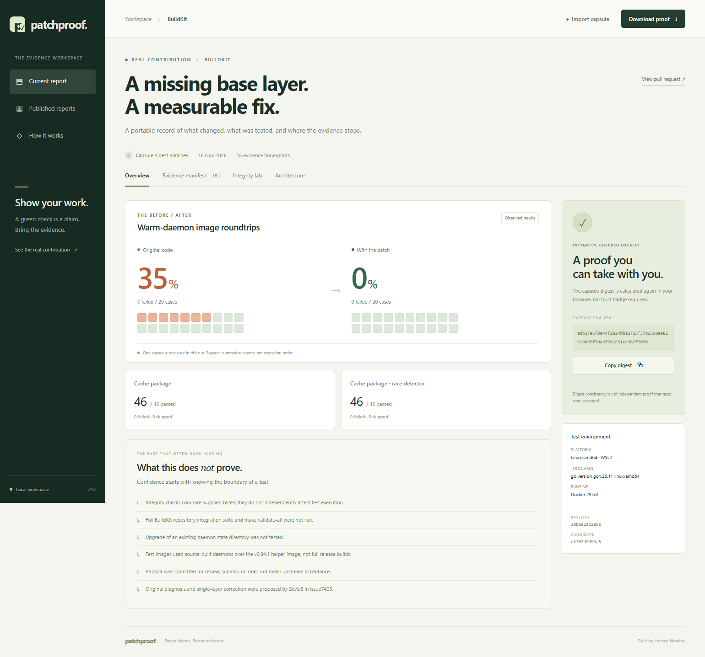

# PatchProof

**Show your work. Take the evidence with you.**

PatchProof turns a patch's before/after results into a portable, content-addressed
report. Reviewers can see the test boundary, check original files without
uploading them, and verify a downloaded capsule without this website.



## Honest status

The local application, real example, HTTP API, independent Python/JavaScript
verification and browser flows have been tested. A temporary AWS deployment
also passed real Lambda/S3/DynamoDB smoke checks on November 16, 2026. See
[validation](docs/VALIDATION.md) for the latest exact checks and cloud status.

The AWS runtime is a single Lambda Function URL, a private S3 capsule bucket,
and a DynamoDB metadata index. No VM, deployment pipeline or paid AI API.
Default deployment is blocked unless an active no-charge **FREE account plan**
is verified. An owner can separately authorize a temporary metered demo with
recording and cleanup; that mode can incur charges and has no hard dollar cap.
Having credits or a budget alarm on a PAID account is not a no-charge guarantee.

## Run locally — no cloud credentials

Python3.12+ and Node20+ are sufficient for development and tests. No Python
package installation is needed for the local app or offline verifier.

```sh
python -m patchproof.local
# Open http://127.0.0.1:8787
```

The local publisher token is generated in `.local/publisher-token`, never
embedded in the browser. Keep `.local/` private and out of version control.

```sh
python -m patchproof.cli examples/buildkit.capsule.json \
  --publish http://127.0.0.1:8787 --token-file .local/publisher-token
```

Open Published reports to find its immutable permalink. Importing a capsule
through the browser stays local; it does not publish anything.

## Verify independently

```sh
python -m patchproof.cli examples/buildkit.capsule.json
python -m patchproof.cli report.json --files ./my-original-evidence
```

Verification compares the payload digest and selected original bytes. It does
not establish that the claims are truthful, complete, independently executed,
or sufficient to prove a patch correct. The integrity lab demonstrates this
boundary by changing a disposable copy of a result, never the stored capsule.

## The real example

The included capsule comes from actual Linux/amd64 validation of
[BuildKit PR7424](https://github.com/moby/buildkit/pull/7424): original master
lost base layers in7/20 image roundtrips; the candidate in0/20. All46 top-level
cache tests passed both normally and under the race detector. Its16 evidence
fingerprints were checked against the original files before importing.

The issue's diagnosis and one-layer correction were proposed by
[Sevla8 in issue7403](https://github.com/moby/buildkit/issues/7403). The
contribution adds regression and legacy-record handling; it is not a claim
that we discovered the original bug. PR submission is not upstream acceptance.
PatchProof is the new application; the existing contribution is its example.
No raw BuildKit logs, account IDs or local absolute paths are shipped.

To rebuild the capsule from your retained validation receipts:

```sh
python -m patchproof.import_buildkit /path/to/verified-receipts examples/buildkit.capsule.json
```

## Test

```sh
python -m unittest discover -s tests -v
npm ci --ignore-scripts --no-audit --no-fund
# On Linux, install a local test browser if needed:
npx playwright install chromium
python -m patchproof.local
# In another terminal:
npm run test:browser
```

On Windows browser tests use installed Chrome; set `CHROME_PATH` to override.
Set `PATCHPROOF_URL` to exercise a deployed instance. Browser tests save actual
desktop/mobile screenshots and a receipt under `artifacts/`. They do not know
the publisher capability and never perform authorized cloud writes.

## AWS deployment

Follow [the deployment runbook](docs/DEPLOYMENT.md). The default command is
read-only. No account creation, plan upgrade, domain purchase or paid service
is performed automatically.

```sh
python tools/deploy.py                 # preflight only
python tools/package.py                # deterministic local ZIP, no AWS call
# Only after preflight verifies your ACTIVE FREE account and you approve it:
python tools/deploy.py --deploy --accept-free-plan
python tools/smoke.py                  # real Lambda + S3 + DynamoDB test
```

Do not call the project AWS-deployed or submit a working-cloud demo until the
smoke test actually passes. A Free plan can expire or exhaust credits; check
its duration covers the judging period. No deployment script upgrades it.

## Format and API

See [capsule format](docs/FORMAT.md), [architecture](web/architecture.svg),
[security boundaries](docs/SECURITY.md), [article draft](docs/CHALLENGE-ARTICLE.md)
and [demo script](docs/DEMO.md). The app validates bounded JSON only; it does
not execute uploaded code, fetch submitted URLs or scan repositories.

Built by Hristos Nenkov with AI assistance. MIT licensed.
