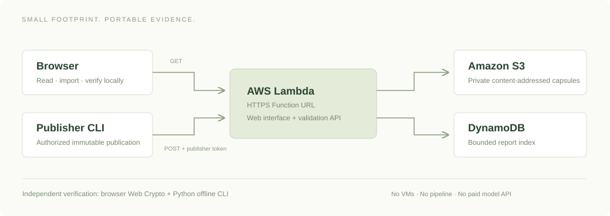

# PatchProof: software fixes, with receipts

**AWS demo:** temporary deployment, recorded before teardown to limit cost.
**Demo:** https://www.youtube.com/watch?v=qVsiOaKjZ9s
**Source:** https://github.com/ChrisX101010/patchproof

## The problem

While preparing a BuildKit contribution, I ended up with a useful result and
an awkward pile of evidence: logs, summaries, hashes, compiler runs and notes
about what I had not tested. A green check could not tell the whole story.

The original daemon lost image base layers in seven of twenty local image
roundtrips. With the candidate patch, the same scenario failed zero times in
twenty attempts. But that does not mean every integration test passed, that
an upgrade was tested, or that an upstream maintainer accepted the patch.
Those distinctions matter to somebody reviewing a contribution.

PatchProof puts the result and its boundaries in the same place.

## What I built

A report is a portable JSON capsule. It includes before/after counts, commit
identities, test scope, explicit limitations and fingerprints of original
evidence files. Its SHA256 digest is also its immutable report identifier.

You can import a capsule without uploading it, inspect the report, download
it again and verify it independently with a small Python CLI. If you have the
original files, the browser compares their bytes locally. The files never
leave your machine. The integrity lab changes a copy of one number so you
can see why the digest no longer matches.

There is an important boundary: matching hashes prove consistency with the
provided bytes, not that someone independently ran the tests. PatchProof says
that directly. It is a way to make a claim inspectable, not a machine for
turning a claim into truth.

## The serverless build

A Lambda Function URL serves both the interface and a bounded HTTP API.
There is no separate web server or deployment pipeline. A private S3 bucket
stores capsules under their content digests. DynamoDB indexes the small
report summaries, so browsing does not require listing all the evidence.

Publishing requires a private capability, supplied by the CLI. Public
visitors can read and verify, but cannot add reports. S3 conditional writes
make repeat publication idempotent. If the metadata index write is
interrupted, resubmitting the same capsule repairs the index without changing
the stored proof. That failure path is covered with an explicit AWS adapter
test double; the normal service path is checked by the cloud smoke runner.

The deployable Python/web ZIP is small and uses no paid AI API, virtual
machine, VPC or domain. A CloudFormation template describes the services and
their permissions. A local SQLite adapter runs the same application for
development without an AWS account.

On November 16, the real AWS deployment passed HTTP, unauthorized-write,
S3 publication/read, DynamoDB listing and repeat-publication smoke checks.
The video demonstrates that deployment. The demo is temporary: I remove
its resources after recording rather than leave a billable endpoint running.

## Testing the thing that presents tests

I checked schema rejection, tampered payloads, Python/JavaScript canonical
byte agreement, concurrent duplicate publication, corrupt stored content,
publisher authorization and deployment-plan checks. Actual browser tests
cover import, export, original-file verification, the tamper demonstration
and mobile layout. The test receipts distinguish local tests, AWS adapter
doubles and a real deployment smoke test; none substitutes for the others.

The bundled example uses real validation for BuildKit PR7424. Credit for the
original issue diagnosis and suggested one-layer correction belongs to
Sevla8 in issue #7403. PatchProof is the new project, not a claim to have
discovered that bug or to have already merged its fix.

## Why it is useful beyond this weekend

Maintainers should not have to reconstruct a contributor's test environment
from screenshots or infer scope from a passing badge. A capsule gives them
something small to inspect, download, compare and keep. The format is
documented, the verifier works offline, and the implementation is open source.

I would next add authenticated execution provenance from existing CI systems.
That needs a separate trust model; I have not labelled content hashes as
attestations to make the demo look stronger.

Built by Hristos Nenkov with AI assistance. The project and its limitations
are available in the source repository.
